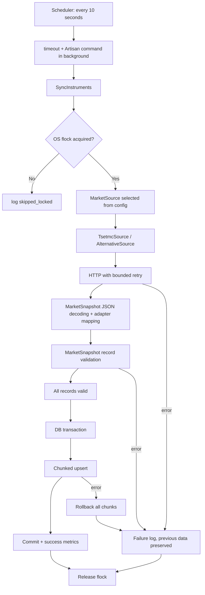

# مستند ارائه و دفاع فنی پروژه Market Watch

نسخهٔ تحویل: 2026-10-30 16:09 به وقت تهران. محل پروژه: `/var/www/market-watch`.

ساده‌سازی ساختار 2026-10-31: پوشهٔ `app/Market` اکنون ۸ فایل دارد. خواندن دقیق JSON و اعتبارسنجی رکوردها داخل `MarketSnapshot` انجام می‌شوند؛ مدیریت قفل نیز داخل `SyncInstruments` است. هر snapshot آرایه‌ای از رکوردهای معتبر را نگه می‌دارد و برای هر ردیف شیء جداگانه ساخته نمی‌شود. جداسازی منبع‌ها و قرارداد مشترک دریافت برای امکان تعویض API حفظ شده‌اند.

به‌روزرسانی 2026-10-31: صفحهٔ اصلی در `http://127.0.0.1:8013/` اکنون یک دیده‌بان فارسی است. نمادهای ذخیره‌شده، قیمت‌ها، حجم و ارزش معاملات را در جدول نشان می‌دهد و جست‌وجو، صفحه‌بندی، زمان آخرین ذخیره و تازه‌سازی خودکار ۱۰ثانیه‌ای دارد. پیاده‌سازی آن در `app/Http/Controllers/InstrumentIndexController.php` و `resources/views/instruments/index.blade.php` است؛ سه تست تازه در `tests/Feature/InstrumentDashboardTest.php` اضافه شد. بخش‌های اندازه‌گیری و شمارش تست در پایین این سند مربوط به تحویل اولیهٔ 2026-10-30 هستند.

به‌روزرسانی اجرای محلی 2026-10-31: سرویس‌های کاربری `market-watch-mysql`، `market-watch-web` و `market-watch-scheduler` نصب و فعال شدند. وب‌سرور پورت 8013، دیتابیس و زمان‌بند پس از بسته شدن ترمینال نیز اجرا می‌مانند و با ورود دوبارهٔ کاربر خودکار شروع می‌شوند. وضعیت آن‌ها با `systemctl --user status market-watch-mysql market-watch-web market-watch-scheduler` قابل بررسی است.

**بازبینی نهایی 2026-10-31:** مجموعهٔ کامل تست‌ها پس از افزودن هشدار دادهٔ قدیمی با **61 تست و 229 assertion موفق** اجرا شد. `composer validate --strict`، بررسی Pint برای `app`، `routes` و `tests`، نحو اسکریپت‌های shell و صحت فایل‌های systemd هم موفق بودند. صفحهٔ اصلی و `/up` هر دو پاسخ HTTP 200 دادند. پس از حذف دو زمان‌بند اضافیِ باقی‌مانده از نشست‌های آزمایشی، فقط سرویس `market-watch-scheduler` برای این پروژه فعال است؛ هر سه سرویس پروژه `active` و `enabled` هستند. دیتابیس در زمان بازبینی 3840 نماد با **صفر شناسهٔ تکراری** داشت. دریافت زندهٔ TSETMC پس از راه‌اندازی مجدد نیز موفق بود؛ `MAX(synced_at)` از 07:42:13 به 07:43:13 UTC رسید. یک timeout واقعی نیز ثبت شد و داده‌ها در آن خطا حفظ شدند. صفحه از این پس، پس از یک دقیقه بدون ذخیرهٔ موفق، هشدار قدیمی‌بودن داده را نشان می‌دهد؛ این هشدار علت خطا را تشخیص نمی‌دهد.

MySQL اختصاصی این محیط برای تک‌نمونهٔ محلی و بدون replication است. `bin/run-local-db` و `bin/local-db` اکنون با `--skip-log-bin` راه می‌افتند؛ مقدار واقعی `log_bin=OFF` بعد از راه‌اندازی مجدد تأیید شد. این کار جلوی رشد فایل‌های binary log را می‌گیرد؛ فایل‌های قبلی برای احتیاط پاک نشده‌اند. این تنظیم را برای MySQL دارای replication یا نیازمند بازیابی نقطه‌ای بدون بررسی نیازهای پشتیبان‌گیری کپی نکنید.

### راهنمای سریع سناریوهای عملیاتی

| وضعیت | رفتار برنامه | بررسی و اقدام |
|---|---|---|
| دریافت موفق | نمادهای موجود به‌روزرسانی و نمادهای تازه درج می‌شوند؛ یک شناسه فقط یک ردیف دارد | زمان «آخرین ذخیرهٔ موفق» در صفحه و `market_sync` با `status=success` در `storage/logs/laravel.log` را ببینید. |
| کندی، timeout، خطای HTTP یا قطع API | دادهٔ قبلی می‌ماند؛ تلاش بعدی زمان‌بند انجام می‌شود؛ پس از یک دقیقه صفحه هشدار قدیمی‌بودن داده می‌دهد | `market_sync` با `status=failed` و متن `reason` را بررسی کنید. اگر اختلال منبع پایدار است، URL یا کلاس منبع جایگزین را پس از تأیید سازگاری داده در `.env` تنظیم و config را پاک کنید. تغییر خودکار منبع در این نسخه وجود ندارد. |
| پاسخ خالی، JSON خراب، فیلد نامعتبر یا شناسهٔ تکراری در پاسخ | کل snapshot رد می‌شود و دادهٔ قبلی تغییر نمی‌کند | `reason` و نمونهٔ پاسخ را بررسی کنید؛ نگاشت منبع را فقط پس از تأیید schema اصلاح کنید. |
| خطای ذخیره در میانهٔ دسته‌ها | تراکنش همهٔ دسته‌ها را برمی‌گرداند و قفل آزاد می‌شود | خطای دیتابیس را در لاگ ببینید؛ پس از رفع علت، اجرای بعدی دوباره تلاش می‌کند. |
| هم‌پوشانی دو اجرا | اجرای دوم با `skipped_locked` کنار می‌رود و داده را دست نمی‌زند | اگر تکرار زیاد شد، مدت دریافت و تعداد فرایندهای `schedule:work` همین پروژه را بررسی کنید؛ فقط یک سرویس زمان‌بند لازم است. |
| توقف سرویس یا خاموشی دیتابیس | همگام‌سازی تازه انجام نمی‌شود و صفحه ممکن است خطای سرویس بدهد | `systemctl --user status market-watch-mysql market-watch-web market-watch-scheduler` را بررسی و پس از رفع علت سرویس مربوط را `restart` کنید. |

برای بررسی سن داده و یکتایی ردیف‌ها:

```bash
mysql --socket=/var/www/market-watch/storage/mysql.sock -uroot -e \
  'SELECT COUNT(*) AS rows_count, COUNT(DISTINCT instrument_code) AS unique_count, MAX(synced_at) AS last_sync_utc FROM market_watch.instruments;'
```

این برنامه، پاسخ دیده‌بان بازار TSETMC را دریافت می‌کند، کل پاسخ را پیش از نوشتن اعتبارسنجی می‌کند و نمادها را به‌صورت گروهی در MySQL درج یا به‌روزرسانی می‌کند. Scheduler هر ۱۰ ثانیه فرصت اجرای تازه ایجاد می‌کند. اگر اجرای قبلی هنوز فعال باشد، اجرای جدید کنار گذاشته می‌شود.

**وضعیت واقعی تحویل اولیه:** پروژه ساخته و migration اجرا شد؛ 54 تست با 188 assertion موفق شد. یک اجرای مستقیم زنده ۱۰۶۵ رکورد را با ۳ دستور `upsert` همگام کرد. سپس Scheduler با منبع واقعی راه افتاد و چند اجرای زندهٔ موفق با پاسخ‌های ۱۰۶۵ و ۳۴۵۸ رکوردی ثبت کرد. تفاوت تعداد پاسخ با URL یکسان، مسئله‌ای مشاهده‌شده در منبع بالادست است؛ علت آن تأیید نشده است. در زمان تهیهٔ گزارش اولیه، راه‌اندازی خودکار نصب نشده بود؛ وضعیت فعلی در یادداشت به‌روزرسانی بالا آمده است.

این فایل برای فهم، اجرا و ارائهٔ پروژه کافی است. نتیجهٔ تست‌های شبیه‌سازی‌شده، بازپخش فایل واقعی و اتصال زنده در متن از هم مشخص شده‌اند. شواهد خام در `/var/www/market-watch/storage/evidence` نگهداری می‌شوند.

## ۱. شرح مسئله و معیارهای پذیرش

| خواسته | محل پیاده‌سازی و شاهد |
|---|---|
| دریافت اطلاعات بازار | `app/Market/TsetmcSource.php` و `MarketHttpClient.php`؛ اجرای واقعی در `storage/evidence/live-sync.txt` |
| انتخاب ۱۰ فیلد خوانا | `MarketSnapshot::FIELDS` و migration جدول؛ نگاشت در بخش ۳ |
| دقیقاً یک رکورد برای هر شناسهٔ نماد | ایندکس UNIQUE واقعی روی `instrument_code`؛ تست درج مستقیم تکراری روی MySQL |
| درج و به‌روزرسانی در هر اجرا | `SyncInstruments::run` و `DB::table(...)->upsert(...)` |
| اجرای خودکار هر ۱۰ ثانیه | `routes/console.php`، `everyTenSeconds()` و `runInBackground()`؛ smoke test واقعی Scheduler |
| تغییر منبع با کلاس و تنظیمات | قرارداد `MarketSource`، binding تنظیم‌محور در `AppServiceProvider` و کلاس `AlternativeSource` |
| حفظ اطلاعات هنگام خطا | اعتبارسنجی کامل قبل از تراکنش و rollback همهٔ دسته‌ها؛ تست HTTP Fake و خطای واقعی MySQL |
| ثبت موفقیت و شکست | رخداد `market_sync` و رخداد پایان ناموفق فرایند `market_sync_process_failed` |
| عملیات محدود دیتابیس | اندازهٔ دسته ۵۰۰؛ ۱۰ دستور ذخیره‌سازی برای ۵۰۰۰ رکورد |
| تست مستقل از اینترنت | Fake کردن فقط مرز HTTP؛ parser، تبدیل، قفل، سرویس و دیتابیس واقعی‌اند |
| مستند آموزشی فارسی | همین فایل، همراه با سناریوی ارائه و دمو |

موضوع پروژه، همگام‌سازی آخرین وضعیت است؛ تاریخچهٔ معاملات یا سامانهٔ خریدوفروش نیست. هر شناسهٔ نماد یک ردیف دارد. تغییر نام نماد، ردیف جدید ایجاد نمی‌کند.

## ۲. راه‌اندازی از صفر و اجرای روزمره

### محیط انتخاب‌شده و علت

محیط واقعی: Linux/Ubuntu، PHP **8.3.6**، Composer **2.7.1**، Laravel **13.39.0**، MySQL **8.0.46** با InnoDB و PHPUnit **12.5.42**. نسخه‌های دقیق وابستگی‌ها در `composer.lock` قفل شده‌اند.

PHP نصب‌شده با Laravel 13 سازگار است؛ حداقل PHP این شاخه 8.3 است. استفاده از شاخهٔ جاری، نسبت به شروع پروژهٔ جدید با شاخهٔ قدیمی‌تر موجه بود. مبنای این تصمیم، [یادداشت انتشار رسمی Laravel](https://laravel.com/framework/docs/releases) است. افزونهٔ SQLite در محیط نبود؛ تست‌ها را روی MySQL واقعی اجرا کردم تا نتیجهٔ یکتایی، Decimal و rollback به موتور پیشنهادی پروژه نزدیک باشد.

افزونه‌های مورد استفاده شامل `pdo_mysql`، `curl`، `mbstring`، `dom/xml`، `openssl` و JSON هستند. PHP 8.3 تابع `json_validate` را هم فراهم می‌کند. ابزار Linux به نام `/usr/bin/timeout` برای سقف اجرای فرایند استفاده می‌شود. برای backend این تسک نیازی به نصب Node یا build رابط کاربری نیست.

Laravel Boost طبق `AGENTS.md` تولیدشدهٔ اسکلت Laravel، به‌عنوان وابستگی توسعه نصب شد؛ بخشی از مسیر دریافت و ذخیرهٔ داده نیست.

### نصب پروژهٔ تحویل‌شده

در پروژهٔ موجود این تحویل، `.env`، کلید برنامه و دیتابیس آماده‌اند. برای نصب مجدد از فایل‌های پروژه:

```bash
cd /var/www/market-watch
composer install --no-interaction --prefer-dist
cp .env.example .env
php artisan key:generate --no-interaction
bin/local-db start
php artisan migrate --no-interaction
php artisan instruments:sync
```

`composer install` از lock استفاده می‌کند؛ `composer update` برای بازتولید همین نسخه‌ها لازم نیست. کلید برنامه برای رمزنگاری امکانات Laravel است و ارتباطی با کلید API ندارد؛ endpoint بررسی‌شده کلید API مطالبه نکرد.

### دیتابیس اختصاصی محیط توسعه

به حساب‌های MySQL موجود سیستم دسترسی بدون رمز فراهم نبود. به‌جای خواندن اطلاعات ورود پروژه‌های دیگر یا دستکاری آن‌ها، یک نمونهٔ مستقل از همان MySQL نصب‌شده ساخته شد:

- فایل‌ها: `storage/mysql-data`
- socket: `/var/www/market-watch/storage/mysql.sock`
- لاگ موتور: `storage/mysql.log`
- دسترسی شبکه: خاموش با `--skip-networking` و `--mysqlx=0`
- binary log: خاموش با `--skip-log-bin` در همین نمونهٔ محلی
- دیتابیس برنامه: `market_watch`
- دیتابیس تست: `market_watch_testing`
- دیتابیس benchmark: `market_watch_benchmark`

فرمان مستقیم `/usr/sbin/mysqld` برای datadir پروژه با خطای دسترسی روبه‌رو شد. کپی محلی همان فایل اجرایی در `work/mysqld` با `--basedir=/usr` کار کرد؛ علت دقیق محدودیت سیستم‌عامل مستقلاً تأیید نشده است. اسکریپت `bin/local-db` این راه‌اندازی محلی را قابل تکرار می‌کند. datadir مجوز ۷۰۰ و socket مجوز ۶۰۰ دارد. حساب root بدون رمز فقط در همین نمونهٔ محلی و پشت socket محدود استفاده می‌شود. این انتخاب مخصوص آزمایش محلی است؛ در سرور از حساب دارای مجوز محدود و تنظیمات دیتابیس سازمان استفاده کنید.

```bash
cd /var/www/market-watch
bin/local-db status
bin/local-db start
# فقط برای خاموش کردن نمونهٔ اختصاصی همین پروژه:
bin/local-db stop
```

این اسکریپت سرویس MySQL سراسری سیستم را خاموش نمی‌کند. ابتدا Scheduler را متوقف کنید و بعد دیتابیس محلی را خاموش کنید.

تنظیمات اصلی `.env` در تحویل:

```dotenv
DB_CONNECTION=mysql
DB_DATABASE=market_watch
DB_USERNAME=root
DB_PASSWORD=
DB_SOCKET=/var/www/market-watch/storage/mysql.sock
CACHE_STORE=file
QUEUE_CONNECTION=sync
SESSION_DRIVER=file
```

اگر محل پروژه تغییر کرد، مسیر socket و مسیرهای absolute در مثال‌ها را اصلاح کنید. برای دیتابیس معمولی شبکه‌ای، `DB_SOCKET` را خالی و host، port، username و password درست را تنظیم کنید. تست‌ها را روی دیتابیس دادهٔ واقعی اجرا نکنید؛ migrationهای تست می‌توانند جدول‌ها را بازسازی کنند.

### Scheduler و Worker

برای توسعه و نمایش:

```bash
cd /var/www/market-watch
bin/run-scheduler
# معادل:
php artisan schedule:work --no-interaction
```

این فرمان در foreground می‌ماند. `Ctrl+C` فرایند foreground را متوقف می‌کند؛ اجرای پس‌زمینهٔ فعلی ممکن است تا سقف زمانی خود ادامه پیدا کند. `schedule:work` معمولاً اجرای دقیقهٔ بعدی را انتظار می‌کشد؛ از لحظهٔ شروع ترمینال، اجرای فوری تضمین نمی‌شود. اجرای دستی با `instruments:sync` فوری است.

برای اجرای پایدار محلی، سه سرویس کاربری پروژه اکنون نصب شده‌اند. فایل‌های unit در `deploy/` قرار دارند. دستورات مدیریت:

```bash
systemctl --user status market-watch-mysql market-watch-web market-watch-scheduler
systemctl --user restart market-watch-mysql market-watch-web market-watch-scheduler
```

در نصب تازه، ابتدا `bin/local-db start` را برای آماده‌سازی دیتابیس اجرا کنید، سپس هر سه unit را با `systemctl --user link` و `systemctl --user enable --now` فعال کنید. روش cron زیر جایگزین سرویس Scheduler است.

روش cron، مطابق [مستند رسمی زمان‌بندی Laravel](https://laravel.com/framework/docs/scheduling):

```cron
* * * * * cd /var/www/market-watch && /usr/bin/php artisan schedule:run >> /var/www/market-watch/storage/logs/cron.log 2>&1
```

Cron فقط هر دقیقه اجرا می‌شود، اما Laravel به‌دلیل وظیفهٔ زیر یک دقیقه، تا پایان همان دقیقه زنده می‌ماند و تلاش‌های ۱۰ثانیه‌ای را انجام می‌دهد. هم‌زمان فقط یکی از روش‌های cron یا سرویس Scheduler را فعال کنید. سرویس کاربری پس از ورود دوبارهٔ کاربر خودکار شروع می‌شود؛ اجرا پیش از ورود کاربر به تنظیمات linger وابسته است.

**Queue Worker لازم نیست.** اجرای پس‌زمینهٔ یک فرمان سیستم با Job صفی فرق دارد. این پروژه صفی برای انباشتن درخواست‌های همگام‌سازی نمی‌سازد؛ در نتیجه فرمان `queue:work` جزو راه‌اندازی نیست.

```bash
php artisan schedule:list --no-interaction
# خروجی باید interval برابر 10s نشان بدهد.
```

بعد از تغییر `.env` در محیط دارای config cache:

```bash
php artisan config:clear --no-interaction
# در استقرار نهایی، پس از تنظیم محیط:
php artisan config:cache --no-interaction
```

برای استقرار، `php artisan schedule:interrupt` می‌تواند اجرای زیر یک دقیقهٔ قدیمی را پایان بدهد؛ قفل فرایند جاری و مسیر storage باید بین نسخه‌های مستقر ثابت بماند.

### اجرای تست و بررسی سبک کد

```bash
cd /var/www/market-watch
cp .env.testing.example .env.testing
php artisan key:generate --env=testing --no-interaction
bin/local-db start
php artisan test --compact
# همراه گزارش قابل پردازش:
php artisan test --compact --log-junit storage/evidence/phpunit.xml
```

در تحویل `.env.testing` از قبل آماده است؛ بازنویسی آن برای اجرای معمول لازم نیست. `phpunit.xml` اتصال MySQL و دیتابیس `market_watch_testing` را انتخاب می‌کند. لازم است موتور محلی در حال اجرا باشد؛ اینترنت لازم نیست.

فرمت PHP با Pint بررسی و اصلاح شد. فرمان `pint --dirty --format agent` در این محیط به‌دلیل نبود مخزن Git قابل استفاده نبود؛ اجرای Pint روی مسیرهای تغییرکرده انجام شد:

```bash
vendor/bin/pint --format agent app/Market app/Console/Commands \
  app/Providers/AppServiceProvider.php config/market.php routes/console.php \
  tests/Feature/MarketSyncTest.php tests/Feature/AtomicStorageTest.php \
  tests/Feature/SchedulerTest.php tests/Fixtures/SlowSource.php \
  database/migrations/2026_10_30_121732_create_instruments_table.php
```

## ۳. شناخت پاسخ واقعی و ۱۰ فیلد بورسی

### آنچه واقعاً دریافت و مشاهده شد

نشانی اولیهٔ تسک:

```text
http://cdn.tsetmc.com/api/ClosingPrice/GetMarketWatch?market=0&paperTypes[0]=1
```

در آزمایش اول، HTTP پاسخ 303 به HTTPS داد و ادامهٔ همان درخواست به 403 رسید. درخواست مستقیم HTTPS در تلاش‌های دیگر موفق شد. تنظیم پیش‌فرض برنامه همان مسیر و query را با HTTPS و براکت‌های URL-encoded استفاده می‌کند:

```text
https://cdn.tsetmc.com/api/ClosingPrice/GetMarketWatch?market=0&paperTypes%5B0%5D=1
```

`%5B` و `%5D` شکل کدشدهٔ `[` و `]` در URL هستند. دنبال کردن redirect در کلاینت برنامه خاموش است؛ تغییر مسیر با خطا رد می‌شود تا بودجهٔ زمانی درخواست محدود بماند. این تصمیم علت استفادهٔ مستقیم از HTTPS در تنظیمات است.

قبل از طراحی migration، نمونهٔ زندهٔ JSON دریافت شد. فایل `storage/evidence/tsetmc-live-response.json` دارای ۱۰۶۵ رکورد است؛ SHA-256 آن:

```text
2854c262a7356d8700ded4ed383a3b21ab82be77dc6a976fceeb3f36531ec9dc
```

مشخصات نمونه در `api-observation.json` ثبت شده است. پاسخ ریشه‌ای به شکل `{"marketwatch":[...]}` بود؛ `insCode` رشته بود و مقادیر عددی عمدتاً با نمایش اعشاری مثل `18260.0` آمده بودند. هیچ شناسهٔ تکراری در این نمونه نبود.

نمونهٔ کوتاه واقعی:

```json
{
  "insCode": "31879190587976736",
  "lva": "خوساز",
  "lvc": "محورسازان‌ايران‌خودرو",
  "pdv": 18260.0,
  "pcl": 18000.0,
  "py": 18220.0,
  "pf": 17900.0,
  "qtj": 806518.0,
  "qtc": 14516223770.0,
  "ztt": 214.0
}
```

همین رکورد فیلدهای `pDrCotVal`، `pClosing`، `qTotTran5J`، `qTotCap` و `zTotTran` را نیز داشت که صفر بودند. انتخاب این نام‌های ظاهراً آشنا به‌جای کلیدهای کوتاه، دادهٔ غلط تولید می‌کرد. هیچ fallback خاموشی به آن کلیدها اضافه نشده است؛ تغییر schema باید آشکارا خطا بدهد.

دادهٔ تودرتوی `marketwatch[i].blDs[j]` مربوط به سطوح سفارش در پاسخ است و برای ۱۰ فیلد این تسک لازم نیست. هر ۱۰ فیلد انتخابی مستقیماً در همان رکورد `marketwatch[i]` هستند. کلید عمومی `id` در نمونه صفر بود و شناسهٔ یکتا نیست.

### معنای فیلترها و حد اعتبار بررسی

از ساختار URL می‌توان دید `market` انتخاب بازار و `paperTypes` فهرست کدهای نوع اوراق است؛ `[0]` اندیس اولین عضو آرایه و `1` مقدار آن است. تفسیر رایج `market=0` پوشش همهٔ بازارهاست، اما برای این endpoint سند رسمی enumها در این بررسی در دسترس قرار نگرفت. **نام رسمی کد نوع اوراق ۱ و انحصاری بودن خروجی به سهام عادی، مستقلاً تأیید نشده است.** این مورد را در مصاحبه به‌عنوان محدودیت شناخت منبع توضیح بدهید.

همان query در بعضی پاسخ‌ها ۱۰۶۵ و در بعضی پاسخ‌ها ۳۴۵۸ رکورد برگرداند؛ نمونهٔ بزرگ‌تر شامل نمادهای اختیار و صندوق هم بود. این اختلاف در اجرای برنامه نیز دیده شد، پس صرفاً تفاوت ابزار curl و PHP نبود. علت، cache، رفتار سرور یا شرایط دیگری می‌تواند باشد؛ هیچ‌یک اثبات نشده است. بنابراین برنامه فیلتر محلی حدسی روی نوع نماد اعمال نمی‌کند و همان پاسخ معتبر endpoint را ذخیره می‌کند. برای تضمین دامنهٔ دقیق «فقط سهام»، تأیید رسمی رفتار پارامترها هنوز لازم است.

### معنی قیمت، حجم و ارزش

آخرین قیمت، قیمت آخرین معاملهٔ ثبت‌شده است؛ قیمت پایانی، مقدار محاسبه‌شدهٔ پایان/مبنای روز طبق قواعد بازار است. این دو لزوماً برابر نیستند و برنامه قیمت پایانی را از آخرین قیمت محاسبه نمی‌کند. حجم، تعداد واحد معامله‌شده است؛ تعداد معاملات، تعداد رخداد معامله است؛ ارزش معاملات، مجموع ارزش پولی معاملات است و با ارزش کل شرکت فرق دارد.

در نگاشت این منبع، قرارداد واحد قیمت و ارزش **ریال** و حجم **تعداد واحد اوراق** است. خود JSON فیلد unit ندارد؛ تأیید رسمی مستقل واحد و ضرایب تمام انواع ابزار در این بررسی فراهم نشد. دادهٔ خام بدون تقسیم بر ۱۰ یا ضریب حدسی ذخیره می‌شود؛ مخصوصاً برای قراردادهای مشتقه نباید برابری سادهٔ `قیمت × حجم = ارزش` را همواره فرض کرد. منبع دوم واقعی باید واحدهایش را در adapter به قرارداد مشترک تبدیل کند.

کنترل سازگاری روی نمونهٔ سهام خوساز: `pdv - py = 40` با `pc` و `pcl - py = -220` با `pcpc` در همان پاسخ سازگار بود. نسبت ارزش به حجم تقریباً ۱۷۹۹۸٫۶۵ است و به قیمت پایانی ۱۸۰۰۰ نزدیک است. این شواهد معنای نگاشت را تقویت می‌کنند؛ جای سند رسمی واحدها و فرمول قیمت پایانی را نمی‌گیرند.

### جدول دقیق نگاشت

`i` اندیس رکورد در آرایهٔ پاسخ است.

| ستون دیتابیس | مسیر دقیق JSON | نوع ذخیره | دلیل انتخاب / معنی |
|---|---|---|---|
| `instrument_code` | `marketwatch[i].insCode` | `VARCHAR(64)` با UNIQUE و collation باینری | هویت پایدار نماد، مستقل از تغییر عنوان |
| `symbol` | `marketwatch[i].lva` | `VARCHAR(80)` | عنوان کوتاه قابل نمایش و جست‌وجو |
| `company_name` | `marketwatch[i].lvc` | `VARCHAR(255)` | نام کامل ناشر یا ابزار |
| `last_price` | `marketwatch[i].pdv` | `DECIMAL(30,4)` نامنفی | آخرین قیمت دریافتی از منبع |
| `closing_price` | `marketwatch[i].pcl` | `DECIMAL(30,4)` نامنفی | قیمت پایانی دریافتی |
| `previous_closing_price` | `marketwatch[i].py` | `DECIMAL(30,4)` نامنفی | پایانی روز قبلی برای مقایسه |
| `opening_price` | `marketwatch[i].pf` | `DECIMAL(30,4)` نامنفی | اولین قیمت معامله |
| `trade_volume` | `marketwatch[i].qtj` | `DECIMAL(28,0)` نامنفی | تعداد واحد معامله‌شده |
| `trade_value` | `marketwatch[i].qtc` | `DECIMAL(30,4)` نامنفی | ارزش پولی معاملات |
| `trade_count` | `marketwatch[i].ztt` | `DECIMAL(28,0)` نامنفی | تعداد معاملات |

`DECIMAL(p,s)` یعنی عدد دقیق با `p` رقم کل و `s` رقم اعشار. محدودهٔ ستون‌های `(30,4)` از صفر تا `10^26 - 0.0001` و ستون‌های `(28,0)` از صفر تا `10^28 - 1` است. مقدار خارج از این محدوده یا اعشار بیش از ظرفیت، رد می‌شود و گرد نمی‌شود.

بیشینه‌های واقعی نمونهٔ ۱۰۶۵تایی: آخرین قیمت ۴۴۸۱۰۰، حجم ۳۶۰۳۵۳۸۲۱۶، ارزش ۱۶۱۹۱۴۶۱۰۶۵۰۰۰ و تعداد معاملات ۲۰۰۵۲۰۹. از این اعداد برای انتخاب ظرفیتی با حاشیهٔ مناسب استفاده شد؛ قرار نیست هر مقدار بی‌نهایت بزرگی را بپذیریم.

شناسه عدد محاسباتی نیست، بنابراین به رشته تبدیل و همان‌طور نگهداری می‌شود. در adapter بورس فقط ۱ تا ۲۰ رقم، بدون صفر ابتدایی و بدون مقدار صفر پذیرفته می‌شود. decoder همهٔ توکن‌های عددی JSON را دقیقاً به متن تبدیل می‌کند؛ شناسهٔ عددی صحیح خام نیز فقط اگر همین قاعده را داشته باشد به همان شناسهٔ متنی می‌رسد. نسخهٔ اعشاری یا علمی شناسه پذیرفته نیست. قرارداد عمومی شناسه تا ۶۴ کاراکتر ASCII از حروف، اعداد و `._:-` را مجاز می‌داند تا به یک ارائه‌دهنده وابسته نباشد. منبع جدید باید همان هویت canonical، یعنی شناسهٔ مشترک یک ابزار، را تولید کند.

### ستون‌های مدیریتی و دقت عدد

`id` کلید داخلی خودافزا، `created_at` زمان اولین درج، `updated_at` زمان آخرین upsert و `synced_at` زمان اعمال snapshot معتبر در برنامه است. این چهار ستون جزو ۱۰ دادهٔ انتخابی نیستند. زمان‌ها UTC و با دقت میکروثانیه هستند؛ زمان تهران برابر UTC به‌علاوهٔ ۳:۳۰ است. `synced_at` زمان معاملهٔ بورس نیست. چون تاریخ/زمان بعضی فیلدهای API صفر بود، تاریخ معاملاتی حدسی ساخته نشده است.

در update، `id` و `created_at` تغییر نمی‌کنند. در اجرای یکسان، timestamps به‌روز می‌شوند، ولی رکورد تکراری ساخته نمی‌شود. «هم‌توانی» یا idempotency در اینجا به نتیجهٔ تجاری و یکتایی رکورد مربوط است، نه ثابت ماندن زمان مشاهده.

استفادهٔ صرف از `json_decode` برای اعداد اعشاری می‌تواند از مسیر float دقت را از دست بدهد. متد خصوصی `MarketSnapshot::decodeJson` ابتدا با `json_validate` صحت JSON اصلی را بررسی می‌کند، سپس فقط توکن‌های عددی خارج از رشته‌ها را به متن تبدیل و JSON را decode می‌کند. بررسی اولیه لازم است تا تبدیل عدد، JSON خراب مثل کلید عددی بدون کوتیشن را تصادفاً معتبر نکند. سپس `Brick\Math\BigDecimal` در `validateQuote` با حساب دقیق، مقیاس و محدوده را کنترل می‌کند. عدد `9007199254740993.1234` در تست تا دیتابیس دقیق حفظ شد. از float برای مبلغ استفاده نمی‌شود؛ زمان‌سنجی‌ها طبیعتاً float هستند.

## ۴. معماری و مسئولیت کلاس‌ها



| فایل | مسئولیت |
|---|---|
| `app/Console/Commands/SyncInstruments.php` | ورودی Artisan، خروجی JSON موفقیت و exit code شکست |
| `app/Market/MarketSource.php` | قرارداد کوچک منبع: فقط `fetch(): MarketSnapshot` |
| `app/Market/TsetmcSource.php` | URL تنظیم‌شده، envelope و کلیدهای اختصاصی بورس و تبدیل آن‌ها |
| `app/Market/AlternativeSource.php` | مثال منبع HTTP دوم با URL و JSON تودرتوی متفاوت |
| `app/Market/MarketHttpClient.php` | timeout، درخواست GET و retry محدود؛ بدون منطق دیتابیس |
| `app/Market/MarketSnapshot.php` | خواندن دقیق JSON، اعتبارسنجی هر رکورد و ساخت snapshot کامل با کنترل تکرار شناسه‌ها |
| `app/Market/SyncInstruments.php` | گرفتن قفل، اجرای منبع، تراکنش، upsert و اندازه‌گیری مراحل |
| `app/Market/FixtureSource.php` | بازپخش آفلاین داده برای دمو و benchmark |
| `app/Market/FeedFailure.php` | انتقال علت شکست همراه آمار معلوم مرحلهٔ دریافت/تبدیل |
| `app/Providers/AppServiceProvider.php` | اتصال قرارداد به کلاس انتخاب‌شده در تنظیمات |
| `config/market.php` | تنظیم منبع، URLها، timeout، اندازهٔ دسته و مسیر قفل |
| `routes/console.php` | زمان‌بندی و لاگ پایان ناموفق فرایند پس‌زمینه |
| `bin/sync-market` | اجرای Artisan با همان PHP زمان‌بند؛ سقف ۴۰ ثانیه با TERM و ۵ ثانیه فرصت تا KILL |
| `database/migrations/2026_10_30_121732_create_instruments_table.php` | ساخت جدول، نوع ستون‌ها و قید یکتایی |

`FixtureSource` برای بازپخش آفلاین فایل JSON و دمو است؛ پیش‌فرض برنامه نیست. این کلاس از همان parser بورس استفاده می‌کند. `Tests\Fixtures\SlowSource` فقط ابزار smoke test دستی است و عمداً ۱۲ ثانیه منتظر می‌ماند. تأخیر آن اندازه‌گیری شبکه نیست.

## ۵. مسیر یک اجرای موفق و یک شکست

در اجرا، Artisan فرمان را پیدا و سرویس را از container لاراول دریافت می‌کند. container همان سازوکاری است که وابستگی‌های سازنده را می‌سازد و قرارداد منبع را به کلاس انتخاب‌شده وصل می‌کند.

مسیر موفق:

1. زمان کل با ساعت یکنواخت `hrtime` شروع می‌شود. این ساعت با تغییر ساعت سیستم عقب و جلو نمی‌رود.
2. `flock` به‌صورت فوری و بدون انتظار گرفته می‌شود. تنها دارندهٔ قفل ادامه می‌دهد.
3. منبع، درخواست HTTP را بیرون از هر تراکنش دیتابیس انجام می‌دهد.
4. JSON، envelope، همهٔ رکوردها، فیلدها، محدوده‌ها و تکرار شناسه‌ها بررسی می‌شوند.
5. متد خصوصی `MarketSnapshot::validateQuote` هر رکورد را به آرایهٔ معتبر با فیلدهای مشترک تبدیل می‌کند. نام‌ها trim و tab/newline به فاصله تبدیل می‌شوند؛ سایر کنترل‌کاراکترها رد می‌شوند. این پاک‌سازی بر اساس tab مشاهده‌شده در نام‌های پاسخ واقعی اضافه شد.
6. ردیف‌های مستقل از منبع با یک timestamp مشترک ساخته و برای ترتیب ثابت نوشتن بر اساس شناسه مرتب می‌شوند.
7. یک تراکنش شروع و برای هر حداکثر ۵۰۰ ردیف، یک upsert اجرا می‌شود.
8. پس از commit، وضعیت موفق، تعداد و مدت مراحل لاگ و روی stdout چاپ می‌شود.
9. بلوک `finally` قفل را آزاد می‌کند.

در خطای شبکه، HTTP، JSON یا رکورد، هنوز نوشتنی آغاز نشده است. در خطای دیتابیس، exception از تراکنش بیرون می‌آید و تمام دسته‌ها rollback می‌شوند. علت و اندازه‌گیری معلوم ثبت، قفل آزاد و فرمان با کد غیرصفر تمام می‌شود. هیچ حذف یا صفرگذاری جبرانی انجام نمی‌شود.

نمونهٔ خروجی اجرای زندهٔ ثبت‌شده:

```text
source = App\Market\TsetmcSource
status = success
received = 1065
valid = 1065
fetch_ms = 3753.492880
transform_ms = 33.538084
store_ms = 51.018032
upsert_statements = 3
total_ms = 3838.610864
```

برای مشاهدهٔ رفتار روزمره:

```bash
cd /var/www/market-watch
tail -f storage/logs/laravel.log storage/logs/scheduler.log
```

لاگ `testing` مربوط به تست‌هاست؛ لاگ `local` در این محیط برای اجرای برنامه است. در شکست پیش از خواندن آرایه، تعداد دریافت‌شده `null` یعنی نامعلوم است؛ آرایهٔ خالی، تعداد صفر دارد. در snapshot نیمه‌معتبر، `valid` تعداد ردیف‌هایی است که تا نقطهٔ کشف خطا با موفقیت بررسی شده‌اند، نه شمارش کامل همهٔ ردیف‌های ممکن.

## ۶. Clean Code، SOLID و Patternهای واقعاً استفاده‌شده

**مسئولیت واحد یا SRP:** نگاشت کلیدهای بورس در adapter است، ساخت دادهٔ معتبر در `MarketSnapshot` و کنترل چرخهٔ همگام‌سازی، شامل قفل و تراکنش، در `SyncInstruments` است. تغییر endpoint نباید migration یا سرویس ذخیره را تغییر بدهد.

**باز بودن برای توسعه یا OCP:** می‌توان کلاس جدیدی با قرارداد `MarketSource` ساخت و `MARKET_SOURCE` را عوض کرد. برای این تغییر نیازی به ویرایش فرمان یا سرویس همگام‌سازی نیست.

**جایگزینی یا LSP:** هر منبع باید همان snapshot معتبر را برگرداند یا exception بدهد. تفاوت ساختار JSON به لایهٔ ذخیره نشت نمی‌کند؛ تست جایگزینی منبع، همان ردیف را با حفظ `id` به‌روزرسانی می‌کند.

**کوچک بودن قرارداد یا ISP:** قرارداد منبع تنها یک متد دارد. متدهای غیرلازم برای دانلود تاریخچه، سفارش، احراز هویت یا حذف نماد به آن تحمیل نشده است.

**وارونگی وابستگی یا DIP:** سرویس به `MarketSource` وابسته است، نه `TsetmcSource`. سازنده‌ها وابستگی‌ها را دریافت می‌کنند؛ HTTP در تست با ابزار رسمی Laravel جایگزین می‌شود.

Patternهای قابل دفاع:

- **Strategy:** پیاده‌سازی‌های مختلف `MarketSource` راه‌های قابل‌جایگزین دریافت داده‌اند؛ محل استفاده در سازندهٔ `SyncInstruments` و binding در provider است.
- **Adapter:** `TsetmcSource` و `AlternativeSource` واژگان و شکل دادهٔ بیرونی را به قرارداد مشترک تبدیل می‌کنند. مسئلهٔ حل‌شده، تغییر کلیدها و ساختار ارائه‌دهنده است.
- **DTO:** `MarketSnapshot` حامل یک مجموعهٔ کامل از آرایه‌های اعتبارسنجی‌شده است و `readonly` از تغییر ناخواستهٔ داده پس از اعتبارسنجی جلوگیری می‌کند. DTO یعنی شیء انتقال داده؛ در اینجا محدودیت‌های داده هم در زمان ساخت اعمال می‌شود.
- **Dependency Injection:** اتصال از طریق container و سازنده‌ها انجام می‌شود؛ تعویض منبع در تست و پیکربندی را ساده می‌کند.

تراکنش و قفل، ابزارهای کنترل صحت هستند؛ لازم نیست برای بلندتر کردن فهرست Patternها، اسم طراحی دیگری به آن‌ها بدهیم.

عمداً repository interface عمومی، service interface بی‌مصرف، event bus، CQRS، لایهٔ domain پیچیده، Eloquent model بدون نیاز، و Queue اضافه نشده‌اند. برای bulk write مستقیم، Query Builder کافی است. جداول پیش‌فرض users/cache/jobs از اسکلت Laravel باقی مانده‌اند، اما مسیر همگام‌سازی به آن‌ها وابسته نیست. SOLID با تعداد کلاس‌ها سنجیده نمی‌شود؛ مرز تغییرپذیری منبع، نیاز واقعی این پروژه بوده است.

## ۷. تعویض منبع با یک کلاس و تنظیمات

منبع نمونهٔ دوم envelope به نام `items` دارد و قیمت/فعالیت را تودرتو برمی‌گرداند:

```json
{
  "items": [{
    "code": "31879190587976736",
    "ticker": "نمونه‌بدیل",
    "issuer": "شرکت نمونه منبع دوم",
    "prices": {"last":"19000.25","close":"18900","previous":"18220","open":"18500"},
    "activity": {"volume":"100","value":"1900025","count":"3"}
  }]
}
```

کلاس موجود `AlternativeSource` یک مثال کامل است. هر منبع تازه کافی است `MarketSource` را پیاده‌سازی کند، درخواست خودش را از URL تنظیم‌شده بگیرد و نگاشت کلیدها به فیلدهای مشترک را به `MarketSnapshot::fromJson` بدهد. این متد همهٔ رکوردها را اعتبارسنجی و snapshot را می‌سازد؛ دریافت HTTP نیز با `MarketHttpClient` قابل استفادهٔ مجدد است. اگر واحد منبع تومان است، تبدیل دقیق به ریال باید داخل همان adapter انجام شود؛ سرویس ذخیره از واحد بیرونی خبر ندارد.

تنظیمات لازم برای مثال موجود:

```dotenv
MARKET_SOURCE='App\Market\AlternativeSource'
ALTERNATIVE_MARKET_URL=http://127.0.0.1:18091/alternative.json
```

برای افزودن adapter سوم، تعریف binding جدید لازم نیست؛ provider بررسی می‌کند کلاس تنظیم‌شده واقعاً قرارداد را پیاده‌سازی کرده باشد. تنظیمات deployment دادهٔ مورد اعتماد مدیر برنامه‌اند؛ کلاس از ورودی HTTP کاربر انتخاب نمی‌شود.

اثبات فقط Mock کامل نبود: در تست، HTTP منبع دوم Fake شد اما بقیهٔ مسیر و دیتابیس واقعی بود. علاوه بر آن، فایل `tests/Fixtures/alternative.json` با وب‌سرور محلی PHP از HTTP واقعی دریافت شد. `AlternativeSource` یک ردیف را در دیتابیس مستقل smoke test به‌روزرسانی کرد؛ تعداد ردیف‌های آن دیتابیس ۲ ماند و قیمت به `19000.2500` تغییر کرد. نتیجه در `storage/evidence/alternative-http-demo.txt` موجود است. این API محلی نمونه است؛ ارائه‌دهندهٔ بورس دیگری در اینترنت تأیید نشده است.

شناسهٔ مشترک شرط مهم تعویض منبع است: اگر ارائه‌دهندهٔ تازه فقط ISIN بدهد، خود adapter باید آن را به هویت canonical مورد توافق تبدیل کند؛ تغییر سادهٔ نام کلید بدون تطبیق هویت می‌تواند ردیف دیگری بسازد. تضمین یکتایی به یکسان بودن معنای شناسهٔ ورودی وابسته است.

## ۸. حفظ داده، تراکنش و هم‌زمانی

### سیاست اعتبارسنجی

| وضعیت | رفتار قطعی |
|---|---|
| مقدار عددی صفر | معتبر؛ با null اشتباه نمی‌شود و می‌تواند مقدار قبلی را به صفر به‌روزرسانی کند |
| null یا فیلد انتخابی مفقود | رد کل snapshot؛ هیچ فیلدی با صفر یا null جایگزین نمی‌شود |
| یک ردیف نامعتبر در میان ردیف‌های معتبر | رد همهٔ پاسخ پیش از شروع نوشتن |
| شناسهٔ تکراری، حتی با دادهٔ کاملاً برابر | رد همهٔ پاسخ؛ انتخاب تصادفی اولین/آخرین ردیف انجام نمی‌شود |
| شناسهٔ نامعتبر | رد کل پاسخ |
| آرایهٔ خالی | شکست اجرا، حفظ تمام رکوردهای قبلی |
| JSON خراب، envelope متفاوت یا رکورد scalar | شکست پیش از نوشتن |
| بیش از ۲۰۰۰۰ رکورد | رد پاسخ برای محدود کردن حجم پردازش؛ تغییر این سقف در config ممکن است |
| اعداد منفی، boolean، اعشار غیرمجاز یا overflow | رد پاسخ، بدون rounding |
| نبود یک نماد در پاسخ تازه | ردیف قبلی حفظ می‌شود؛ نبودن به معنی مجوز حذف نیست |
| tab/newline در نام | تبدیل به فاصله و trim؛ کنترل‌کاراکترهایی مثل NUL رد می‌شوند |

این سیاست به سازگاری snapshot اولویت می‌دهد: با یک ردیف خراب، دادهٔ تازهٔ سایر نمادها نیز اعمال نمی‌شود. هزینهٔ آن کاهش تازگی داده هنگام اشکال محدود منبع است؛ مزیتش جلوگیری از snapshot ترکیبی و پنهان ماندن خرابی schema است.

### چرا یک تراکنش برای همهٔ دسته‌ها؟

`upsert` یعنی درج ردیف جدید و update ردیفی که با قید یکتا برخورد کرده است. در MySQL، تشخیص برخورد بر ایندکس واقعی انجام می‌شود؛ آرگومان نام کلید به‌تنهایی جای UNIQUE را نمی‌گیرد.

بدون تراکنش، موفق شدن دستهٔ اول و شکست دستهٔ دوم، دیتابیس را نیمه‌به‌روز می‌کند. اینجا همهٔ upsertها داخل یک `DB::transaction` و روی InnoDB هستند. تست `AtomicStorageTest` یک trigger واقعی MySQL ساخت که روی نماد دستهٔ دوم `SIGNAL SQLSTATE '45000'` می‌دهد. به‌روزرسانی دستهٔ اول برگشت، ردیف دوم درج نشد، timestamps قبلی حفظ شد و اجرای بعد از برداشتن trigger موفق شد. Query Builder یا DB در این تست Mock نشده است.

دریافت شبکه قبل از تراکنش است تا تأخیر اینترنت قفل‌های دیتابیس را طولانی نکند. ردیف‌ها پیش از نوشتن مرتب می‌شوند تا ترتیب قفل گرفتن ثابت‌تر باشد. هیچ SELECT برای تشخیص تک‌تک موجود بودن نمادها انجام نمی‌شود.

### قفل بدون انقضا و اجرای بیش از ۱۰ ثانیه

این استقرار روی یک ماشین است. متد خصوصی `SyncInstruments::acquireLock` فایل ثابتی را با حالت `c` باز و `LOCK_EX | LOCK_NB` می‌گیرد؛ فایل در هر اجرا truncate یا حذف نمی‌شود. شکست گرفتن قفل فوری است و وضعیت `skipped_locked` ثبت می‌کند. قفل داخل سرویس است، بنابراین فرمان دستی و Scheduler هر دو مشمول آن‌اند.

قفل TTL یا زمان انقضا ندارد. تا وقتی descriptor فایل در فرایند باز است، قفل برقرار است؛ با `finally` آزاد می‌شود و با مرگ فرایند نیز سیستم‌عامل آن را آزاد می‌کند. بنابراین برخلاف قفل دارای TTL کوتاه، پس از گذشت ۱۰ یا ۳۰ ثانیه اجرای دوم وارد نمی‌شود. وجود فایل روی دیسک به‌تنهایی به معنی قفل بودن نیست؛ فایل را برای آزاد کردن قفل حذف نکنید، چون inode جدید می‌تواند قفل دیگری بسازد.

اگر کار ۱۲ ثانیه طول بکشد، تلاش ثانیهٔ دهم کنار می‌رود؛ پس از پایان، تلاش عادی بعدی فرصت اجرا دارد. هیچ صفی از snapshotهای قدیمی تشکیل نمی‌شود. برنامه تضمین «شروع تلاش هر ۱۰ ثانیه» می‌دهد، نه «دریافت موفق و commit قطعی هر ۱۰ ثانیه» در شبکهٔ کند.

این قفل برای چند میزبان مستقل یا فایل‌سیستم شبکه‌ای تأیید نشده است. برای چنین استقراری باید راهکار مشترک مانند قفل دیتابیس یا Redis با تمدید مالکانه و آزمون متناسب انتخاب شود. در deploymentهای release directory، `MARKET_LOCK_PATH` و storage باید یک مسیر ثابت مشترک روی همین میزبان داشته باشند.

### بودجهٔ زمانی و retry

| لایه | مقدار و سیاست |
|---|---|
| برقراری اتصال HTTP | حداکثر ۴ ثانیه در هر تلاش |
| کل یک درخواست HTTP | حداکثر ۸ ثانیه؛ redirect دنبال نمی‌شود |
| تعداد تلاش HTTP | حداکثر ۲؛ یک فاصلهٔ ۲۰۰ میلی‌ثانیه‌ای |
| موارد retry | خطای اتصال/timeout، وضعیت 429 یا 5xx |
| موارد بدون retry | 4xx دیگر، 3xx و JSON/دادهٔ نامعتبر |
| حداکثر معمول بودجهٔ دریافت | حدود ۱۶٫۲ ثانیه برای دو تلاش؛ سربار سیستم می‌تواند اضافه شود |
| سقف فرمان زمان‌بندی‌شده | `timeout 40s` با TERM و حداکثر ۵ ثانیه فرصت تا KILL |
| انقضای قفل | ندارد؛ طول عمر واقعی فرایند |

timeout اتصال جزئی از timeout کل درخواست است؛ نباید ۴ و ۸ را برای هر تلاش با هم جمع کرد. این مقادیر از مشاهدهٔ اتصال واقعی اصلاح شدند: حد اولیهٔ ۲ ثانیه برای TLS و ۴ ثانیه برای کل درخواست باعث شکست نمونه‌هایی می‌شد که TLS آن‌ها حدود ۲٫۳ ثانیه طول می‌کشید. کندی منبع کاملاً برطرف نشده است و بعضی تلاش‌ها همچنان شکست می‌خورند؛ دادهٔ قبلی محفوظ می‌ماند.

فرمان زمان‌بندی‌شده از طریق اسکریپت مستقل `bin/sync-market` تحت ابزار Linux timeout اجرا می‌شود. زمان‌بند مسیر `PHP_BINARY` را به این اسکریپت می‌دهد؛ اسکریپت به ریشهٔ پروژه می‌رود و فرمان `instruments:sync` را با همان PHP اجرا می‌کند. پس هنگ کردن پردازش یا انتظار طولانی دیتابیس نیز نمی‌تواند فرایند را نامحدود نگه دارد. پس از خروج غیرصفر، callback زمان‌بندی exit code را ثبت می‌کند؛ 124/137 به‌عنوان عبور از مهلت فرایند شناخته می‌شود. اگر خود Scheduler، سیستم‌عامل یا میزبان ناگهان از بین برود، ثبت لاگ نهایی تضمین‌پذیر نیست. قطع اتصال وسط تراکنش از سمت موتور، تراکنش باز را rollback می‌کند؛ کشته شدن دقیق در مرز commit می‌تواند از دید کلاینت نتیجهٔ نامعلوم داشته باشد، اما اجرای مجدد به‌کمک upsert رکورد تکراری نمی‌سازد.

سقف ۴۰ثانیه‌ای مربوط به مسیر Scheduler است. برای اجرای دستی با همان سقف:

```bash
bin/sync-market
```

## ۹. کارایی و نمودار پیشرفت مبتنی بر اندازه‌گیری

### آزمایش کنترل‌شده

فرمان بازتولید:

```bash
cd /var/www/market-watch
php artisan instruments:benchmark --records=5000 --runs=5
```

این فرمان فقط دیتابیس ثابت و مجزای `market_watch_benchmark` را انتخاب می‌کند و جدول instruments آن را برای هر حالت پاک می‌کند؛ به جدول برنامه و تست دست نمی‌زند. دیتابیس باید با اسکریپت محلی یا مدیر MySQL از قبل ساخته شده باشد.

شرایط دستگاه: پردازندهٔ Intel Core i5-12500H، معماری x86_64، Linux 7.0.0-38-generic، دیتابیس روی همین میزبان و OPcache برای CLI خاموش بود. query log برای شمارش دستورها در هر دو حالت فعال بود؛ سربار ثبت تعداد زیاد دستور هم در این اندازه‌گیری وجود دارد. Scheduler نیز روی همین دستگاه فعال بود، بنابراین بار محیط کاملاً ایزوله نبود.

ورودی: ۵۰۰۰ رکورد **مصنوعی**، ساخته‌شده با ساختار یک رکورد واقعی و شناسه‌های مجزای آزمایشی. شبکه در این آزمون وجود ندارد و `fetch_ms=0` است. روی هر حالت ۵ اجرا انجام شد؛ اجرای اول عمدتاً درج و اجراهای بعدی update هستند. همان ترکیب برای هر دو اندازهٔ دسته تکرار شد. عدد گزارش‌شده میانهٔ پنج نمونه است و سنجش آزمایشگاهی قطعی تمام بارهای تولید نیست. جمع میانهٔ مراحل لزوماً میانهٔ زمان کل نیست.

این پروژه پیش از کار وجود نداشت؛ بنابراین baseline از نسخهٔ پیشین محصول نداریم. ستون «قبل» در جدول زیر، **مقایسهٔ کنترل‌شدهٔ همان سرویس با اندازهٔ دستهٔ ۱** است؛ ادعای اندازه‌گیری کد قدیمی یا سیستم قبلی نیست. هر دو حالت یک تراکنش برای کل snapshot دارند.

| بُعد / شاخص | قبل: دستهٔ ۱ | بعد: دستهٔ ۵۰۰ | تغییر / نتیجه | شاهد |
|---|---:|---:|---|---|
| تعداد دستورهای داده‌ای دیتابیس؛ کمتر بهتر | ۵۰۰۰ | ۱۰ | کاهش ۹۹٫۸٪ | query log واقعی |
| میانهٔ ذخیره‌سازی؛ کمتر بهتر | 676.759 ms | 160.109 ms | کاهش 76.3٪ | ۵ اجرای همسان روی MySQL |
| میانهٔ تبدیل و اعتبارسنجی | 140.573 ms | 140.230 ms | اختلاف طبیعی اجرا؛ هدف بهینه‌سازی DB بوده است | parser و BigDecimal واقعی |
| میانهٔ زمان کل؛ کمتر بهتر | 820.606 ms | 305.329 ms | کاهش 62.8٪ | `hrtime`؛ بدون شبکه |
| مقایسه با محصول پیشین | موجود نیست | پروژهٔ جدید | درصد بهبود نسبت به نسخهٔ قدیمی ادعا نمی‌شود | نبود baseline |

دستورهای BEGIN و COMMIT جزو شمارش query log لاراول نیستند؛ با احتساب کنترل تراکنش، برای حالت گروهی معمولاً ۱۰ دستور داده‌ای به‌علاوهٔ دو عملیات کنترل تراکنش داریم. setup، truncate، migration و بررسی count پایانی جزو بازهٔ اندازه‌گیری ذخیره‌سازی نیستند. تعداد درج و update جداگانه گزارش نشده است؛ مقدار affected rows در MySQL برای استنتاج ساده و قابل‌اتکای این دو کافی نیست.

متریک `upsert_statements` تعداد دستورهای با موفقیت اجراشده در آن تلاش است. اگر بعداً rollback شود، این عدد به معنی commit شدن آن دستورها نیست؛ `status` و علت شکست باید همراهش خوانده شوند.

### زمان‌های اجرای واقعی شبکه

در اجرای مستقیم ثبت‌شده با ۱۰۶۵ رکورد: دریافت **۳۷۵۳٫۴۹۳ ms**، تبدیل و اعتبارسنجی **۳۳٫۵۳۸ ms**، ذخیره‌سازی **۵۱٫۰۱۸ ms** و کل **۳۸۳۸٫۶۱۱ ms** بود. شبکه از پردازش برنامه جدا گزارش شده است. `fetch_ms` زمان دیواری دریافت، retry و فاصلهٔ تلاش‌ها را شامل می‌شود؛ benchmark آفلاین آن را صفر گزارش می‌کند.

در اجرای واقعی دیگری با ۳۴۵۸ رکورد، زمان دریافت حدود ۱۰۲۶۳ ms و کل حدود ۱۰۵۰۳ ms شد و تلاش بعدی با `skipped_locked` کنار رفت. این شاهد واقعیِ رفتار بالای ۱۰ ثانیه است؛ با آزمون مصنوعی کند هم هم‌جهت بود. این اعداد promise دائمی latency منبع نیستند.

بهینه‌سازی اصلی، کاهش round-trip دیتابیس با batch upsert است. افزایش بی‌دلیل تعداد worker یا کوتاه کردن timeout به دریافت منبع کمک نمی‌کند. مرتب‌سازی هزینهٔ `O(n log n)` و اعتبارسنجی/تشخیص تکرار هزینهٔ حدود `O(n)` دارد. کل snapshot پیش از نوشتن در حافظه نگهداری می‌شود؛ سقف ۲۰۰۰۰ رکورد برای کنترل این هزینه است، اما محدودیت مستقل حجم بایت پاسخ در این نسخه اضافه نشده است.

## ۱۰. شواهد تست و حدود اعتبار نتایج

اجرای خودکار هنگام تحویل اولیه (نتیجهٔ بازبینی نهایی جدید در ابتدای سند آمده است):

```text
54 tests passed
188 assertions
duration_ms = 1486
```

این تعداد شامل دو تست پیش‌فرض اسکلت Laravel است؛ **52 تست/حالت مستقیماً مربوط به این تسک‌اند**. موارد data provider هرکدام یک اجرای تست شمرده می‌شوند. نسخهٔ PHPUnit و شرایط موتور در بخش ۲ ثبت شده‌اند. گزارش XML دقیق نام‌ها و زمان‌ها در `storage/evidence/phpunit.xml` است.

| سناریو | شاهد اصلی | نتیجهٔ واقعی |
|---|---|---|
| درج نماد جدید و نگاشت قیمت/حجم صحیح | `MarketSyncTest::test_inserts_selected_fields_from_a_real_response_shape` | موفق |
| update بدون ردیف تکراری و با حفظ id/created_at | `test_updates_existing_symbol_preserving_id_and_creation_time` | موفق |
| اجرای چندبارهٔ دادهٔ یکسان | `test_repeated_identical_snapshots_preserve_uniqueness` | موفق |
| نبود یک نماد و حفظ آن | `test_absent_symbols_are_not_deleted` | موفق |
| خطای شبکه و timeout | data provider اتصال؛ کنترل دادهٔ قبلی و اجرای بعدی | موفق |
| HTTP 403/404/302/429/503 و تعداد retry | `httpFailures` | موفق |
| موفقیت پس از 503 موقت | `test_transient_server_failure_is_retried_and_then_succeeds` | موفق |
| آرایهٔ خالی، JSON خراب، HTML، envelope غلط و scalar | `badResponses` | موفق |
| JSON دارای کلید عددی بدون کوتیشن | تست پیش از تبدیل توکن عدد | موفق؛ پاسخ خراب پذیرفته نمی‌شود |
| null، فیلد مفقود، اعداد نامعتبر، اعشار و overflow | `invalidRecords` و تست فیلد مفقود | موفق |
| صفر معتبر | `test_zero_is_a_valid_value_for_all_numeric_fields` | موفق |
| شناسهٔ تکراری داخل یک پاسخ | `test_duplicate_identifiers_reject_even_identical_records` | موفق |
| قید واقعی UNIQUE بیرون از سرویس | insert مستقیم در MySQL | موفق؛ SQLSTATE 23000 |
| دقت بیشتر از محدودهٔ float و عدد علمی حجم | `test_preserves_raw_numeric_precision_beyond_binary_float_range` | موفق |
| whitespace مشاهده‌شده در نام منبع | `test_normalizes_trailing_whitespace_observed_in_live_company_names` | موفق |
| شکست دستهٔ دوم و rollback دستهٔ اول | `AtomicStorageTest` با trigger واقعی | موفق |
| قفل بین دو فرایند و آزاد شدن پس از SIGKILL | فرایند PHP جداگانه در `MarketSyncTest` | موفق |
| تعویض URL/ساختار منبع و حفظ هویت ردیف | `AlternativeSource` در تست | موفق |
| شمار دستورهای دیتابیس | ۱۰۰۱ رکورد و ۳ دستور داده‌ای | موفق |
| لاگ موفقیت/شکست و مدت مراحل | Log spy؛ بقیهٔ مسیر واقعی | موفق |
| تنظیم Scheduler و deadline | `SchedulerTest` | موفق |
| لاگ exit code مهلت و شکست عادی | اجرای callback رویداد با 124 و 1 | موفق |

در ابتدا چند تست به‌علت افزودن Fake جدید روی Fake قبلی پاسخ مورد انتظار را نمی‌گرفتند. مسئلهٔ طراحی تست با یک callback ثابت و پاسخ قابل‌تغییر بین مراحل اصلاح شد؛ تست‌ها واقعاً مسیر شکست را طی کردند. کلید رمزنگاری `.env.testing` نیز برای تست پیش‌فرض HTTP آماده شد. نتیجهٔ نهایی جدول، حاصل اجرای دوباره پس از این اصلاحات است.

تست‌های خودکار فقط HTTP خروجی را Fake می‌کنند و با `preventStrayRequests` اجازهٔ درخواست اینترنتی ناخواسته نمی‌دهند. برای retry، خواب با `Sleep::fake` کنترل می‌شود. Query Builder، تراکنش، parser، تبدیل اعداد، schema و قفل واقعی‌اند. در تست لاگ، خود Log spy می‌شود تا محتوای رخدادها بررسی شود؛ این به معنی شبیه‌سازی کل برنامه نیست.

### بررسی‌های خارج از مجموعهٔ تست خودکار

- **اتصال زنده:** اجرای `php artisan instruments:sync` با `TsetmcSource` و بررسی ردیف/لاگ موفق شد. خطاهای 403، timeout اتصال و timeout پس از دریافت بخشی از بدنه نیز واقعاً مشاهده شدند.
- **بازپخش آفلاین:** پاسخ‌های واقعی ذخیره‌شدهٔ ۱۰۶۵ و ۳۴۵۸ رکوردی از فایل خوانده و ذخیره شدند. این دریافت زنده محسوب نمی‌شود.
- **زمان‌بندی واقعی:** `schedule:work` با منبع آزمایشی ۱۲ثانیه‌ای روی `market_watch_scheduler_test` اجرا شد. تلاش‌ها در 12:26:00، 12:26:10 و 12:26:20 UTC ثبت شدند؛ تلاش ثانیهٔ ۱۰ کنار رفت و موفقیت اول در 12:26:12 ثبت شد. همین الگو برای تلاش‌های ۲۰ و ۳۰ تکرار شد. معادل محلی اولین شروع، **۱۵:۵۶:۰۰ تهران** است. فایل‌های `scheduler-smoke.txt` و `scheduler-events.log` شاهد هستند. یک اجرای کوتاه اولیه نزدیک انتهای دقیقه برای ثبت پایان کار کافی نبود؛ نمونهٔ موفق با `schedule:work` گرفته شد.
- **منبع دوم از HTTP محلی واقعی:** موفق؛ دادهٔ آن نمونه و ساختگی است، هرچند انتقال واقعاً HTTP بود. سرور نمونه بعد از بررسی متوقف شد.
- **Benchmark:** 5 اجرا برای هر یک از دو حالت، با دادهٔ مصنوعی و MySQL واقعی.
- **Composer:** `composer validate --no-check-publish` موفق و `composer audit --no-interaction` در زمان بررسی بدون advisory بود. این نتیجه ضمانت نبود آسیب‌پذیری آینده نیست.
- **Pint و shell:** فرمت مسیرهای PHP اصلاح/بررسی و `bash -n bin/local-db bin/run-scheduler` موفق شد.

آزمون خودکار ۴۰ ثانیه برای kill واقعی اجرای طولانی اجرا نشده است؛ پیکربندی سقف، callback پایان و رفتار واقعی ۱۲ ثانیه/قفل جداگانه بررسی شده‌اند. تست چندمیزبانه، MySQL روی شبکهٔ دور، فشار چند writer مستقل و قطع موتور دقیقاً هنگام COMMIT اجرا نشده‌اند. نتیجهٔ قفل به Linux و فایل‌سیستم محلی این دستگاه محدود است. تست‌های دیتابیس روی MySQL بوده‌اند؛ ادعای تأیید PostgreSQL یا SQLite مطرح نیست.

### وضعیت دیتابیس برنامه و محل شواهد

هنگام بررسی، `market_watch.instruments` دارای **۳۴۵۸ ردیف و ۳۴۵۸ شناسهٔ یکتا** بود. بازپخش نمونهٔ بزرگ‌تر و سپس دریافت‌های زندهٔ بزرگ‌تر آن‌ها را ایجاد/تأیید کردند؛ پاسخ کوچک‌تر باعث حذف آن‌ها نشده است. این count را با تعداد هر پاسخ ورودی یکی نگیرید. Scheduler فعال است و timestamps پس از زمان این گزارش تغییر می‌کنند.

برای بررسی مستقیم:

```bash
mysql --socket=/var/www/market-watch/storage/mysql.sock -u root -e \
'SELECT COUNT(*) AS records, COUNT(DISTINCT instrument_code) AS unique_records FROM market_watch.instruments;'
```

| شاهد | مسیر از ریشهٔ پروژه |
|---|---|
| پاسخ اولیهٔ واقعی و مشخصات آن | `storage/evidence/tsetmc-live-response.json`, `api-observation.json` |
| پاسخ بزرگ‌تر واقعی | `storage/evidence/tsetmc-live-expanded-response.json` |
| خروجی اجرای مستقیم زنده | `storage/evidence/live-sync.txt` |
| گزیدهٔ لاگ دریافت‌های زنده | `storage/evidence/live-events.log` |
| بررسی schema و رکورد نمونه | `storage/evidence/database-check.txt` |
| نتیجهٔ تست‌ها | `storage/evidence/tests-summary.json`, `phpunit.xml` |
| همهٔ نمونه‌های benchmark | `storage/evidence/benchmark.json` |
| شواهد Scheduler کند | `storage/evidence/scheduler-smoke.txt`, `scheduler-events.log` |
| دمو HTTP منبع دوم | `storage/evidence/alternative-http-demo.txt` |

این فایل‌ها شواهد توسعه‌اند، نه endpoint عمومی برنامه. پوشهٔ `public` تنها document root مجاز وب‌سرور است؛ `.env`، storage و ریشهٔ پروژه را عمومی سرو نکنید.

## ۱۱. تصمیم‌ها، هزینه‌ها و محدودیت‌ها

| تصمیم | مزیت | هزینه یا حد اعتبار |
|---|---|---|
| فرمان پس‌زمینه بدون صف | snapshot قدیمی در صف جمع نمی‌شود؛ استقرار ساده | به Scheduler و ابزار Linux وابسته است |
| قفل OS بدون TTL | تمام طول واقعی اجرا و مرگ فرایند را پوشش می‌دهد | برای چند میزبان مستقل کافی نیست |
| رد کامل snapshot نیمه‌معتبر | خرابی داده پنهان نمی‌شود؛ snapshot نیمه‌تازه ساخته نمی‌شود | یک ردیف خراب، تازگی کل پاسخ را متوقف می‌کند |
| Decimal و حفظ متن عدد | جلوگیری از از دست رفتن دقت | CPU بیشتری از float و کد decode دقیق لازم دارد |
| batch size برابر ۵۰۰ | کاهش محسوس دستورها، اندازهٔ معقول statement | مقدار بهینهٔ مطلق همهٔ سرورها نیست |
| یک تراکنش برای همهٔ دسته‌ها | جلوگیری از update نیمه‌کاره | تراکنش طولانی‌تر از هر دسته به‌تنهایی است |
| عدم حذف ردیف غایب | حفظ داده هنگام پاسخ ناقص بالادست | تشخیص حذف دائمی/توقف نماد به سیاست جدا نیاز دارد |
| نگهداری فقط آخرین snapshot | متناسب با صورت تسک و حجم کم‌تر | تاریخچه، stale detection و جلوگیری از پس‌رفت زمانی اضافه نشده است |

باقی‌مانده‌های مشخص: سند رسمی enum فیلترهای همین endpoint و unit همهٔ انواع ابزار دریافت نشد؛ اختلاف تعداد پاسخ هنوز توضیح قطعی ندارد. کد براساس کلیدهای **مشاهده‌شده** ساخته شد، اما نام‌گذاری تجاری و قرارداد واحد، سطح اطمینان متفاوتی از مشاهدهٔ مستقیم کلید و مقدار دارند. برای توسعهٔ تولیدی محدود به یک نوع ابزار، این تأیید مهم‌ترین اقدام بعدی است.

اجرای زندهٔ موفق به معنی پایدار بودن آیندهٔ CDN نیست. برنامه در قطع یا خرابی API دادهٔ قبلی را حفظ می‌کند، ولی نمی‌تواند دادهٔ تازهٔ منبع قطع‌شده را بسازد. snapshot معتبر از نظر ساختار ممکن است از نظر زمانی قدیمی باشد؛ چون تاریخ معتبر و ثابت snapshot از منبع تأیید نشده، سیاست ضدپس‌رفت زمانی حدسی اضافه نشده است.

## ۱۲. سناریوی ارائهٔ ۵ تا ۱۰ دقیقه‌ای

**دقیقهٔ ۰ تا ۱ — مسئله و خطر اصلی:**

«هدف من این بود که هر ده ثانیه آخرین وضعیت نمادها را بگیرم، اما دادهٔ قبلی در خطا آسیب نبیند. دو مسئلهٔ اصلی را جدا کردم: شناخت درست پاسخ بیرونی و اعمال اتمیک آن در دیتابیس. ابتدا API را واقعاً صدا زدم. دیدم فیلدهای کوتاه مثل pdv و pcl مقدار دارند، در حالی که بعضی فیلدهای مشابه با نام کامل صفر بودند؛ بنابراین نگاشت را از روی اسم آشنا حدس نزدم.»

**دقیقهٔ ۱ تا ۲ — داده و هویت:**

«ده فیلد را انتخاب کردم: شناسه، نماد، نام کامل، چهار قیمت و سه شاخص فعالیت. شناسه را رشته گرفتم چون برای محاسبه نیست و ممکن است در تبدیل عددی دقت از بین برود. روی آن UNIQUE واقعی گذاشتم. قیمت و ارزش Decimal هستند. حتی در خواندن JSON هم عدد را اول float نمی‌کنم؛ توکن اصلی را دقیق نگه می‌دارم. تست مبلغ بزرگ‌تر از محدودهٔ دقیق float دارم.»

**دقیقهٔ ۲ تا ۳ — معماری:**

«سرویس همگام‌سازی از TSETMC فقط یک قرارداد به نام MarketSource می‌بیند. adapter منبع مسئول URL، envelope و تبدیل کلیدهاست و یک snapshot مشترک معتبر تحویل می‌دهد. انتخاب کلاس از config است. منبع دوم را با URL متفاوت و prices تودرتو پیاده کردم؛ بدون تغییر سرویس، همان ردیف را update کرد. اینجا Strategy و Adapter مسئلهٔ واقعی تغییر منبع را حل می‌کنند.»

**دقیقهٔ ۳ تا ۴ — حفظ داده:**

«پاسخ را قبل از تراکنش کامل بررسی می‌کنم. صفر معتبر است، اما null و فیلد مفقود را جایگزین صفر نمی‌کنم. پاسخ خالی، شناسهٔ تکراری یا یک رکورد خراب باعث رد کل snapshot می‌شود. نبودن نماد باعث حذف نمی‌شود. بعد همهٔ دسته‌های upsert داخل یک تراکنش قرار می‌گیرند. با trigger واقعی MySQL، شکست دستهٔ دوم را ایجاد کردم و ثابت کردم تغییر دستهٔ اول هم rollback می‌شود.»

**دقیقهٔ ۴ تا ۵ — زمان‌بندی و هم‌زمانی:**

«برای این مسئله صف نساختم تا دادهٔ کهنه پشت هم جمع نشود. Scheduler هر ده ثانیه یک فرمان پس‌زمینه راه می‌اندازد. خود سرویس قبل از دریافت شبکه، flock می‌گیرد. اگر کار قبلی هنوز فعال باشد، اجرای بعدی فوری کنار می‌رود. قفل زمان انقضا ندارد و تا طول عمر واقعی فرایند برقرار است؛ با exception یا مرگ فرایند آزاد می‌شود. فرمان زمان‌بندی سقف چهل ثانیه دارد.»

**دقیقهٔ ۵ تا ۶ — شواهد و کارایی:**

«54 تست موفق دارم که دو موردشان اسکلت Laravel است. بخش دیتابیس روی MySQL واقعی اجرا شده و فقط HTTP بیرونی Fake است. قفل را با دو فرایند واقعی آزمودم. در سنجش پنج‌هزار رکورد، دستهٔ پانصدتایی به جای پنج‌هزار دستور، ده دستور داشت. میانهٔ ذخیره‌سازی از 676.759 به 160.109 میلی‌ثانیه رسید. زمان شبکه را با این benchmark آفلاین قاطی نکردم.»

**دقیقهٔ ۶ تا ۷ — اتصال زنده و محدودیت‌ها:**

«اجرای زندهٔ مستقیم هزار و شصت و پنج رکورد را در حدود ۳٫۸۴ ثانیه همگام کرد. Scheduler واقعی هم چند بار موفق شد. در آزمایش کند، تلاش دهمین ثانیه کنار رفت و اجرای قبلی در دوازده ثانیه تمام شد. محدودیت‌های من روشن‌اند: قفل برای یک میزبان محلی است؛ اختلاف پاسخ هزار و شصت و پنج و سه‌هزار و چهارصد و پنجاه و هشت رکورد با URL یکسان دیده شد و enum رسمی فیلتر را قطعی تأیید نکردم. بنابراین ادعا نمی‌کنم همهٔ معنای منبع یا تمام شرایط تولید را پوشش داده‌ام.»

اگر ۱۰ دقیقه وقت دارید، دو دقیقهٔ آخر را صرف اجرای دمو و نشان دادن رکورد قبل/بعد و یک شکست امن کنید. اگر ۵ دقیقه وقت دارید، جزئیات عددی را خلاصه و روی نگاشت واقعی، مرز منبع، تراکنش و قفل تمرکز کنید.

## ۱۳. پرسش‌های احتمالی مصاحبه و پاسخ کوتاه

**چرا symbol کلید یکتا نیست؟** نام قابل نمایش ممکن است تغییر کند. `insCode` هویت منبع است؛ آن را به `instrument_code` مشترک نگاشت کرده‌ام و UNIQUE واقعی دارم.

**چرا شناسه VARCHAR است؟** با آن جمع و ضرب نداریم؛ می‌خواهم دقت و انعطاف هویت در ارائه‌دهنده‌های مختلف حفظ شود. محدودیت قالب در adapter اعمال می‌شود.

**چرا updateOrCreate در حلقه استفاده نکردید؟** بررسی و نوشتن ردیف‌به‌ردیف تعداد رفت‌وبرگشت دیتابیس را زیاد می‌کند. upsert دسته‌ای به ایندکس یکتا تکیه می‌کند و با ۵۰۰۰ رکورد فقط ۱۰ دستور داده‌ای دارد.

**آیا آرگومان uniqueBy کافی است؟** در MySQL خیر؛ ایندکس یکتای واقعی تعیین‌کننده است. migration و تست insert مستقیم این شرط را نشان می‌دهند.

**چرا شبکه داخل تراکنش نیست؟** کندی اینترنت نباید مدت نگهداری قفل دیتابیس را زیاد کند. قبل از شروع نوشتن، کل snapshot آماده و معتبر است.

**اگر وسط دسته‌ها خطا رخ دهد چه می‌شود؟** همهٔ دسته‌ها در یک تراکنش‌اند؛ خطا به بیرون می‌آید و کل نوشتن rollback می‌شود. این رفتار با trigger واقعی MySQL بررسی شده است.

**اگر پاسخ خالی باشد؟** آن را snapshot جدید معتبر تلقی نمی‌کنم؛ شکست لاگ و دادهٔ قبلی حفظ می‌شود. هیچ delete عمومی نداریم.

**تفاوت صفر و null چیست؟** صفر مقدار معتبر داده است؛ null یعنی مقدار معلوم نیست. null یا فقدان فیلد ضروری موجب رد پاسخ می‌شود؛ صفر می‌تواند مقدار قبلی را update کند.

**اگر اجرا بیش از ده ثانیه طول بکشد؟** تلاش تازه قفل را نمی‌گیرد و کنار می‌رود. صفی برای عقب افتادن کارها وجود ندارد. پس از پایان، تلاش برنامه‌ریزی‌شدهٔ بعدی ادامه می‌دهد.

**چرا فقط withoutOverlapping روی dispatch کافی نبود؟** اگر Job صفی بود، قفل dispatch طول اجرای Worker را پوشش نمی‌داد. اینجا قفل داخل سرویس و دور کل fetch تا commit است و فرمان دستی را هم پوشش می‌دهد.

**اگر TTL قفل تمام شود ولی کار ادامه داشته باشد؟** این قفل TTL ندارد. تا descriptor باز است برقرار می‌ماند؛ timeout فرایند و آزاد شدن قفل را به انقضای زودهنگام وابسته نکرده‌ام.

**اگر فرایند kill شود، فایل قفل باقی نمی‌ماند؟** فایل باقی می‌ماند اما قفل OS با بسته شدن descriptor آزاد می‌شود. حذف فایل راه آزاد کردن قفل نیست.

**چطور چند سرور را پشتیبانی می‌کنید؟** پیاده‌سازی فعلی یک میزبان است. برای چند میزبان قفل مشترک و آزمون واقعی تمدید/مالکیت لازم است؛ ادعای پوشش آن را ندارم.

**تعداد insert و update را چطور شمردید؟** جداگانه نشمردم؛ تعداد رکورد معتبر و دستور upsert را گزارش کردم. affected rows برای گزارش سادهٔ این دو قابل اتکا نیست.

**برای تعویض منبع چه فایل‌هایی تغییر می‌کنند؟** یک کلاس adapter تازه و تنظیم کلاس/URL آن؛ سرویس، فرمان و ذخیره ثابت می‌مانند. تبدیل واحد و شناسهٔ مشترک مسئولیت adapter است.

**چرا همهٔ پاسخ به‌خاطر یک رکورد رد می‌شود؟** سیاست محافظه‌کارانهٔ این تسک است: دادهٔ نیمه‌به‌روز و خرابی schema پنهان نمی‌شود. می‌توان سیاست پذیرش جزئی طراحی کرد، ولی آن تصمیم نیازمند معیار صریح دیگری است.

**آیا تست سبز، اتصال زنده را اثبات می‌کند؟** خیر؛ Fake فقط منطق برنامه را مستقل از اینترنت ثابت می‌کند. برای اتصال زنده، فرمان واقعی جدا و بررسی دیتابیس/لاگ انجام شده است.

**چرا قیمت پایانی را از ارزش تقسیم بر حجم محاسبه نکردید؟** فرمول رسمی همهٔ ابزارها و قواعد حجم مبنا یکسان نیست. مقدار منبع را ذخیره می‌کنم و محاسبهٔ حدسی جایگزینش نمی‌کنم.

## ۱۴. چک‌لیست دمو و وضعیت تحویل

دموها را روی دیتابیس جدا انجام دهید تا Scheduler واقعی و دادهٔ برنامه تغییر نکنند. دو رکورد fixture از پاسخ واقعی گرفته شده‌اند؛ تغییرات دمو و منبع دوم نمونه‌های آزمایشی‌اند.

### آماده‌سازی و درج

```bash
cd /var/www/market-watch
bin/local-db start
mysql --socket=/var/www/market-watch/storage/mysql.sock -u root -e \
'CREATE DATABASE IF NOT EXISTS market_watch_demo CHARACTER SET utf8mb4 COLLATE utf8mb4_unicode_ci;'
DB_DATABASE=market_watch_demo php artisan migrate --force --no-interaction

DB_DATABASE=market_watch_demo MARKET_SOURCE='App\Market\FixtureSource' \
php artisan instruments:sync

mysql --socket=/var/www/market-watch/storage/mysql.sock -u root -e \
'SELECT id,instrument_code,symbol,last_price,created_at FROM market_watch_demo.instruments;'
```

اجرای دوباره همان دو ردیف را حفظ می‌کند؛ count نباید به چهار برسد.

### به‌روزرسانی و حفظ هویت

```bash
mkdir -p work
python3 - <<'PY_DEMO'
import json
from pathlib import Path
value=json.loads(Path('tests/Fixtures/tsetmc.json').read_text())
value['marketwatch'][0]['pdv']='19999.25'
Path('work/demo-update.json').write_text(json.dumps(value,ensure_ascii=False))
PY_DEMO

DB_DATABASE=market_watch_demo MARKET_SOURCE='App\Market\FixtureSource' \
MARKET_FIXTURE_PATH=/var/www/market-watch/work/demo-update.json \
php artisan instruments:sync
```

SELECT قبلی را تکرار کنید: قیمت ردیف اول تغییر کرده، `id` و `created_at` ثابت مانده و تعداد ردیف‌ها دو است.

### پاسخ خالی و حفظ اطلاعات

```bash
printf '%s\n' '{"marketwatch":[]}' > work/demo-empty.json
DB_DATABASE=market_watch_demo MARKET_SOURCE='App\Market\FixtureSource' \
MARKET_FIXTURE_PATH=/var/www/market-watch/work/demo-empty.json \
php artisan instruments:sync
# انتظار: exit غیرصفر، علت خطا و دادهٔ قبلی دست‌نخورده.
```

برای نمایش خطای واقعی شبکهٔ محلی بدون وابستگی به اینترنت، پورتی را انتخاب کنید که listener ندارد:

```bash
DB_DATABASE=market_watch_demo TSETMC_URL=http://127.0.0.1:1/unavailable \
php artisan instruments:sync
```

### تعویض منبع و JSON متفاوت

در ترمینال جدا:

```bash
cd /var/www/market-watch
php -S 127.0.0.1:18091 -t tests/Fixtures
```

در ترمینال دمو:

```bash
cd /var/www/market-watch
DB_DATABASE=market_watch_demo MARKET_SOURCE='App\Market\AlternativeSource' \
ALTERNATIVE_MARKET_URL=http://127.0.0.1:18091/alternative.json \
php artisan instruments:sync
```

همان شناسهٔ ردیف اول به نماد «نمونه‌بدیل» و قیمت `19000.2500` می‌رسد و count همان دو باقی می‌ماند. این دمو نشان می‌دهد URL، envelope، کلیدها و تودرتویی می‌توانند عوض شوند و سرویس ذخیره ثابت بماند. سرور نمونه را بعد از دمو با `Ctrl+C` متوقف کنید.

### نمایش تست‌ها و Scheduler

```bash
php artisan test --compact tests/Feature/AtomicStorageTest.php
php artisan test --compact tests/Feature/MarketSyncTest.php --filter=another_process
php artisan test --compact tests/Feature/SchedulerTest.php
php artisan schedule:list --no-interaction
```

برای تکرار smoke test کند، در یک ترمینال جدا و با دیتابیس دمو:

```bash
DB_DATABASE=market_watch_demo MARKET_SOURCE='Tests\Fixtures\SlowSource' \
MARKET_LOCK_PATH=/var/www/market-watch/storage/app/demo-scheduler.lock \
php artisan schedule:work --no-interaction
```

لاگ را در ترمینال دیگر دنبال کنید؛ شروع Scheduler ممکن است تا دقیقهٔ بعد منتظر بماند. پس از مشاهدهٔ success حدود ۱۲ثانیه‌ای و `skipped_locked`، تست را متوقف کنید. Scheduler عادی پروژه از قفل پیش‌فرض دیگری استفاده می‌کند.

### کارهای تکمیل‌شده

- [x] ساخت پروژهٔ مستقل در `/var/www/market-watch` بدون تغییر پروژه‌های قبلی.
- [x] دریافت نمونهٔ واقعی پیش از تعیین نگاشت و ثبت شواهد آن.
- [x] ۱۰ فیلد مشترک، Decimal دقیق، قید UNIQUE، batch upsert و تراکنش.
- [x] حفظ داده در خطا، پاسخ خالی، JSON خراب، رکورد ناقص و شکست میانی دیتابیس.
- [x] تعویض منبع با تنظیمات، تست HTTP Fake و دمو HTTP محلی واقعی.
- [x] قفل بین‌فرایندی، آزاد شدن پس از خطا/مرگ و اجرای واقعی بیشتر از ۱۰ ثانیه.
- [x] 54 تست موفق، بررسی سبک کد و benchmark واقعی ثبت‌شده.
- [x] اجرای دستی زنده و راه‌اندازی Scheduler با API واقعی.
- [x] مستند مستقل فارسی، سناریوی ارائه، پرسش‌های مصاحبه و دمو.

### اقدامات بعدی به‌ترتیب اهمیت

- [ ] **تأیید باقی‌ماندهٔ شناخت منبع:** گرفتن enum رسمی `market`/`paperTypes` و قرارداد واحد/ضریب ابزارها؛ برای تضمین دامنهٔ دقیق خروجی ضروری است.
- [ ] **در صورت نیاز به اجرای دائمی پس از reboot:** نصب cron یا service نمونه و تنظیم دیتابیس پایدار؛ فایل آماده است، نصب سیستمی انجام نشده.
- [ ] **فقط در صورت چندمیزبانه شدن:** جایگزینی قفل محلی با قفل مشترک مناسب و تست مستقل؛ برای همین ماشین لازم نیست.

هیچ تست یا benchmark بررسی‌نشده‌ای به‌عنوان نتیجهٔ موفق گزارش نشده است. محدودیت‌های اتصال زنده و شناخت فیلتر، بخشی از نتیجهٔ فنی این تحویل‌اند.
